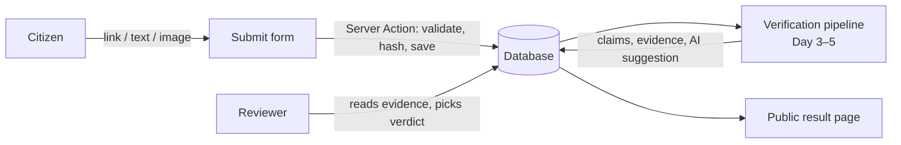

# ElectionVerify

**An AI-assisted platform for checking election information.** Citizens submit a news link, a forwarded
message or an image. The system gathers evidence (source reputation, existing fact-checks, supporting and
contradicting sources, image analysis), and a **human reviewer** decides and publishes the verdict.

> The AI only suggests. Nothing is published without a person checking it.

---

## Run it (no accounts needed)

```bash
npm install
npm run dev
```

Open http://localhost:3000. Without any keys the app runs in **demo mode**: sample data is kept in memory
and you sign in by picking a role on the sign-in page.

| Demo account | Can do |
|---|---|
| Citizen | Submit links, text and images. Follow their progress. |
| Reviewer | Everything above, plus the review queue and publishing verdicts. |
| Admin | Everything above, plus managing trusted sources. |

**Suggested demo for class:** sign in as Citizen → submit a message → see the progress page →
sign in as Reviewer → open *"Photo claims marked ballot papers…"* → read the AI suggestion and evidence →
publish a verdict → open the public result page.

---

## Tech stack (all free)

| Layer | Tool | Free tier |
|---|---|---|
| Framework | Next.js 16 (App Router, Server Actions, Cache Components) + TypeScript | Open source |
| UI | Tailwind CSS 4 + shadcn/ui (Radix) + lucide icons | Open source |
| Validation | zod | Open source |
| Database | PostgreSQL + Prisma 7 | Supabase free tier, or local Postgres |
| Login | Supabase Auth (email link + Google) | Free tier |
| Image storage | Supabase Storage (private bucket, signed links) | Free tier |
| Hosting | Vercel | Hobby plan |

---

## Folder structure

```
app/                          Pages (each folder = a URL)
├─ (public)/                  Pages anyone can see (the brackets don't appear in the URL)
│  ├─ page.tsx                /            Home: hero, how it works, recent verdicts, rating guide
│  ├─ submit/                 /submit      Submit form + Server Action that validates and saves
│  ├─ s/[id]/                 /s/:id       Live progress, then the published verdict and evidence
│  └─ verified/               /verified    All published verdicts, filter by rating
├─ (auth)/                    Sign-in page and sign-in/out Server Actions
├─ auth/callback/route.ts     Where Supabase sends people back after signing in
├─ review/                    /review      Reviewer queue and review workspace (Reviewer role)
├─ admin/sources/             /admin/...   Trusted sources list (Admin role)
└─ layout.tsx                 Header, footer and demo banner shared by every page

components/
├─ ui/                        shadcn/ui building blocks (button, card, table…)
├─ layout/                    Header, footer, account menu, demo banner
├─ home/  submit/  review/  admin/  auth/  evidence/   Components for each feature
└─ verdict-badge.tsx …        Small shared pieces

lib/
├─ data/
│  ├─ repository.ts           The list of data operations the app needs (an interface)
│  ├─ demo-store.ts           …implemented in memory (demo mode)
│  ├─ prisma-store.ts         …implemented with PostgreSQL through Prisma
│  ├─ demo-data.ts            Sample submissions, sources and accounts (all made up)
│  └─ index.ts                Picks a store. Pages import only from here.
├─ auth.ts                    getCurrentUser(), requireRole()
├─ supabase/                  Supabase clients for the server and the proxy
├─ validators.ts              zod rules for every form (checked on the server)
├─ labels.ts                  Verdict names, colours and descriptions
├─ types.ts                   Shared TypeScript types
└─ config.ts                  Reads environment variables, decides demo mode

prisma/
├─ schema.prisma              Database tables
├─ migrations/                SQL history of the schema
└─ seed.ts                    Loads the sample data into a real database

proxy.ts                      Runs before each request (Next.js 16's new name for middleware)
```

---

## How it works



**Submission statuses:** Queued → Analyzing → Awaiting review → Published (or Failed).

**Ratings:** Accurate, Misleading, Missing context, False, Unverified, Satire.

### Design decisions worth explaining

1. **Human in the loop.** The AI's verdict is stored separately (`aiVerdict`) from the reviewer's
   (`finalVerdict`), and only the reviewer's is ever shown to the public.
2. **Citations are checked.** The AI summary cites evidence by ID, like `[ev-5c]`. The review screen links
   each one to its evidence card and highlights any ID that doesn't exist, so made-up sources stand out.
3. **Repository pattern.** Pages talk to `lib/data`, never to the database directly. That is how the same
   code runs on sample data or on PostgreSQL.
4. **Security on the server.** Every form is validated again on the server with zod. Every page and
   action checks the user's role with `requireRole()`. The proxy is only a quick first check.
5. **Duplicates.** Each submission gets a SHA-256 fingerprint. If the same content was already
   published, the user is sent straight to that result.
6. **Fast pages.** With Cache Components, the static parts of each page load instantly and anything that
   reads the database or the login cookie streams in inside a `<Suspense>` boundary with a skeleton.

---

## Connect the real services (free)

1. Create a free project at [supabase.com](https://supabase.com).
2. Copy `.env.example` to `.env` and fill in:
   - `DATABASE_URL`: Project Settings → Database → Connection string
   - `NEXT_PUBLIC_SUPABASE_URL` and `NEXT_PUBLIC_SUPABASE_PUBLISHABLE_KEY`: Project Settings → API Keys
   - `SUPABASE_SECRET_KEY`: same page. Server only, never share it.
   - `ADMIN_EMAILS`: your email, so you become an admin on first sign-in
3. In Supabase, create a **private** Storage bucket named `submissions`.
4. Under Authentication → URL Configuration, add `http://localhost:3000/auth/callback` as a redirect URL.
5. Create the tables and load the sample data:

```bash
npm run db:migrate
npm run db:seed
```

Free Supabase projects pause after a week without use. Open the dashboard before your presentation.

---

## Scripts

| Command | What it does |
|---|---|
| `npm run dev` | Start the development server |
| `npm run build` / `npm start` | Production build / run it |
| `npm run lint` | ESLint |
| `npm run typecheck` | TypeScript check |
| `npm run db:migrate` | Apply schema changes to the database |
| `npm run db:seed` | Load the sample data |
| `npm run db:studio` | Browse the database in the browser |

---

## Roadmap (one week, all free tools)

| Day | Work | Status |
|---|---|---|
| 1 | Project setup, schema, login and roles, all pages with sample data | ✅ Done |
| 2 | Real submissions with Supabase Storage, rate limiting | Form and Server Action done |
| 3 | Pipeline part 1: read the article (`@mozilla/readability`), source reputation, domain age (RDAP), claim extraction | |
| 4 | Pipeline part 2: [Google Fact Check Tools API](https://developers.google.com/fact-check/tools/api) (free), web evidence search, AI summary | |
| 5 | Image analysis: metadata (`exifr`), text in images (`tesseract.js`), reverse image search links for reviewers | |
| 6 | Polish the reviewer workspace, audit log page | |
| 7 | Tests (Vitest + Playwright), deploy to Vercel, demo data | |

**Free choices for the pipeline**

- **Background jobs:** [Inngest](https://www.inngest.com) free plan. Each step retries on its own.
- **AI (claims and summaries):** a provider with a free tier, such as the Google Gemini API or Groq, or a local
  model with Ollama. Check the current free limits and data-use terms before you start.
- **Web search:** Tavily's free monthly credits.
- **OCR:** `tesseract.js`, which runs on your own server.
- **Reverse image search:** buttons that open the image in Google Lens or TinEye for the reviewer.
  Fully automatic reverse search needs a paid API.
